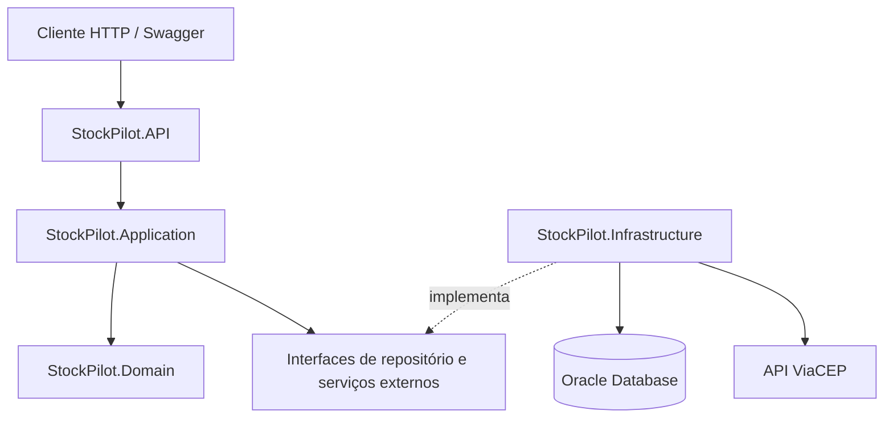

<div align="center">

# 📦 StockPilot API

**API REST para gerenciamento de produtos, fornecedores e controle básico de estoque**  
**ASP.NET Core 8 · Clean Architecture · Oracle Database · JWT · ViaCEP · Swagger/OpenAPI**

[](https://dotnet.microsoft.com/)
[](https://learn.microsoft.com/dotnet/csharp/)
[](https://www.oracle.com/database/)
[](#-testes)
[](#-swagger--openapi)

</div>

---

## 📑 Índice

- [👤 Desenvolvedor](#-desenvolvedor)
- [📚 Sobre o projeto](#-sobre-o-projeto)
- [🏗️ Arquitetura](#️-arquitetura)
- [📁 Estrutura da solução](#-estrutura-da-solução)
- [🚀 Tecnologias utilizadas](#-tecnologias-utilizadas)
- [📦 Entidades e relacionamento](#-entidades-e-relacionamento)
- [🔐 Autenticação e autorização](#-autenticação-e-autorização)
- [📡 Endpoints](#-endpoints)
- [🔗 Paginação e HATEOAS](#-paginação-e-hateoas)
- [🌎 Integração ViaCEP e resiliência](#-integração-viacep-e-resiliência)
- [📄 Respostas HTTP e tratamento de erros](#-respostas-http-e-tratamento-de-erros)
- [📘 Swagger / OpenAPI](#-swagger--openapi)
- [🗄️ Banco de dados e migrations](#️-banco-de-dados-e-migrations)
- [⚙️ Como executar](#️-como-executar)
- [🧪 Testes](#-testes)
- [🎬 Demonstração da API](#-demonstração-da-api)
- [📌 Funcionalidades e escopo](#-funcionalidades-e-escopo)

---

## 👤 Desenvolvedor

<table>
  <tr>
    <td width="130">
      
    </td>
    <td>
      <b>Moisés Barsoti Andrade de Oliveira</b><br/>
      <b>RM:</b> 565049 &nbsp;&nbsp;|&nbsp;&nbsp;<b>Turma:</b> 2TDSPO - FIAP <br/>
    </td>
  </tr>
</table>

---

## 📚 Sobre o projeto

O **StockPilot** é uma API REST para o cadastro e a consulta de **fornecedores** e **produtos**. Cada produto pertence a um fornecedor e possui informações de preço e quantidade disponível em estoque.

No cadastro de um fornecedor, o sistema consulta o **ViaCEP** para preencher cidade e estado a partir do CEP informado. A persistência utiliza **Oracle Database** com **Entity Framework Core**.

A solução também demonstra autenticação com **JWT**, autorização por perfis, validação de dados, paginação, links de navegação (HATEOAS) e testes automatizados.

### Principais responsabilidades

- Cadastrar fornecedores com validação de e-mail único e consulta de CEP;
- Consultar fornecedores por identificador;
- Cadastrar produtos vinculados a fornecedores existentes;
- Consultar produtos por identificador;
- Listar produtos com paginação;
- Proteger operações utilizando JWT e os perfis `ADMIN` e `VIEWER`;
- Tratar erros de negócio e exceções de forma consistente;
- Persistir e consultar dados em um banco Oracle real.

---

## 🏗️ Arquitetura

O projeto utiliza uma organização inspirada em **Clean Architecture**, separando as responsabilidades entre **Domain**, **Application**, **Infrastructure** e **API**.

| Camada | Responsabilidades |
|---|---|
| **StockPilot.Domain** | Entidades `Product` e `Supplier`, `BaseEntity` e exceções de domínio. |
| **StockPilot.Application** | DTOs, contratos de repositório, serviços, validações de negócio, `OperationResult` e `PageResult`. |
| **StockPilot.Infrastructure** | `StockPilotDbContext`, mapeamentos EF Core, migrations, repositórios Oracle, `UnitOfWork` e cliente ViaCEP. |
| **StockPilot.API** | Controllers, configuração de JWT, Swagger/OpenAPI, tratamento global de exceções, injeção de dependências e endpoints HTTP. |
| **tests/** | Testes unitários com xUnit/Moq e testes de integração com `WebApplicationFactory`. |

### Diagrama de fluxo



A solução utiliza **injeção de dependência**, **Repository Pattern**, **Service Layer** e **Unit of Work**. As consultas paginadas utilizam `AsNoTracking`, ordenação determinística e paginação diretamente no banco.

---

## 📁 Estrutura da solução

```text
StockPilot/
├── StockPilot.API/
│   ├── Configurations/
│   │   ├── JwtConfiguration.cs
│   │   └── SwaggerConfiguration.cs
│   ├── Controllers/
│   │   ├── AuthController.cs
│   │   ├── ProductsController.cs
│   │   └── SuppliersController.cs
│   ├── DTOs/Auth/
│   ├── Exceptions/
│   ├── Extensions/
│   ├── Services/
│   └── Program.cs
├── StockPilot.Application/
│   ├── Common/
│   │   ├── Pagination/
│   │   └── Results/
│   ├── DTOs/
│   ├── Interfaces/
│   └── Services/
├── StockPilot.Domain/
│   ├── Common/
│   ├── Entities/
│   └── Exceptions/
├── StockPilot.Infrastructure/
│   ├── Configurations/
│   ├── Data/
│   │   └── Migrations/
│   ├── External/
│   └── Repositories/
├── tests/
│   ├── StockPilot.UnitTests/
│   └── StockPilot.IntegrationTests/
├── .config/dotnet-tools.json
├── .gitignore
├── global.json
├── StockPilot.sln
└── stockpilot-migration.sql
```

O manifesto `.config/dotnet-tools.json` registra a ferramenta `dotnet-ef` utilizada nas migrations.

---

## 🚀 Tecnologias utilizadas

- **C# e .NET 8 / ASP.NET Core Web API**;
- **Entity Framework Core 8** e **Oracle.EntityFrameworkCore**;
- **Oracle Database**, com migrations do EF Core;
- **JWT Bearer Authentication** e autorização por roles;
- **HttpClient** com integração à API [ViaCEP](https://viacep.com.br/);
- **Microsoft.Extensions.Http.Resilience / Polly** para Retry, Timeout e Circuit Breaker;
- **Swagger / OpenAPI 3.0 com Swashbuckle.AspNetCore 6.6.2** e suporte ao botão **Authorize** com JWT Bearer;
- **xUnit**, **Moq**, **WebApplicationFactory** e **Coverlet**;
- **JetBrains Rider**, **Git** e **GitHub**.

---

## 📦 Entidades e relacionamento

### Supplier

Representa um fornecedor cadastrado no sistema.

| Propriedade | Descrição |
|---|---|
| `Id` | Identificador único (`Guid`). |
| `Name` | Nome do fornecedor. |
| `Email` | E-mail único, normalizado para minúsculas. |
| `ZipCode` | CEP com oito dígitos. |
| `City` | Cidade retornada pelo ViaCEP. |
| `State` | UF retornada pelo ViaCEP. |
| `CreatedAt` / `UpdatedAt` | Datas de criação e atualização. |

### Product

Representa um produto vinculado a um fornecedor.

| Propriedade | Descrição |
|---|---|
| `Id` | Identificador único (`Guid`). |
| `Name` | Nome do produto. |
| `Price` | Preço em decimal, com precisão `12,2` no banco. |
| `StockQuantity` | Quantidade disponível. |
| `SupplierId` | Identificador do fornecedor responsável. |
| `CreatedAt` / `UpdatedAt` | Datas de criação e atualização. |

### Relacionamento

```text
Supplier (1) ─────────── (N) Product
    PK: SUPPLIER_ID          PK: PRODUCT_ID
                             FK: SUPPLIER_ID
```

O relacionamento é **1:N**. A FK usa `DeleteBehavior.Restrict`, evitando exclusão em cascata de fornecedores com produtos vinculados.

---

## 🔐 Autenticação e autorização

A API utiliza tokens JWT assinados com **HMAC-SHA256**, emitidos pelo endpoint de login. O token tem validade de **1 hora** e é validado quanto à assinatura, emissor, audiência e expiração.

Para a demonstração acadêmica, existem dois usuários configurados localmente via **User Secrets**. O endpoint de login está disponível apenas no ambiente **Development**.

| Usuário | Perfil | Permissões |
|---|---|---|
| `admin` | `ADMIN` | Consultar e cadastrar produtos e fornecedores. |
| `viewer` | `VIEWER` | Consultar produtos e fornecedores. |

As senhas e a chave de assinatura **não são armazenadas no repositório**.

### Login

```http
POST /api/auth/login
Content-Type: application/json
```

```json
{
  "username": "admin",
  "password": "<SENHA_CONFIGURADA_LOCALMENTE>"
}
```

Em caso de sucesso, a API retorna `accessToken`, `tokenType`, `expiresAtUtc` e `role`. Para acessar endpoints protegidos:

```http
Authorization: Bearer <TOKEN_JWT>
```

**Importante:** o login com usuários de demonstração não constitui um sistema de identidade de produção. O projeto não implementa registro público de usuários, recuperação de senha ou persistência de contas em banco.

---

## 📡 Endpoints

### Autenticação

| Método | Endpoint | Descrição | Acesso |
|---|---|---|---|
| `POST` | `/api/auth/login` | Autentica usuário de demonstração e retorna JWT. | Público, somente Development |

### Produtos

| Método | Endpoint | Descrição | Acesso |
|---|---|---|---|
| `GET` | `/api/products` | Lista produtos com paginação. | `ADMIN` ou `VIEWER` |
| `GET` | `/api/products/{id}` | Consulta produto por `Guid`. | `ADMIN` ou `VIEWER` |
| `POST` | `/api/products` | Cadastra produto. | `ADMIN` |

Exemplo de cadastro:

```json
{
  "name": "Mouse Gamer",
  "price": 129.90,
  "stockQuantity": 15,
  "supplierId": "<GUID_DE_UM_FORNECEDOR_EXISTENTE>"
}
```

### Fornecedores

| Método | Endpoint | Descrição | Acesso |
|---|---|---|---|
| `GET` | `/api/suppliers/{id}` | Consulta fornecedor por `Guid`. | `ADMIN` ou `VIEWER` |
| `POST` | `/api/suppliers` | Cadastra fornecedor e consulta dados do ViaCEP. | `ADMIN` |

Exemplo de cadastro:

```json
{
  "name": "Distribuidora StockPilot",
  "email": "fornecedor@example.com",
  "zipCode": "01001000"
}
```

**Escopo atual:** os Controllers expõem operações de **cadastro e consulta**. Rotas `PUT`, `PATCH`, `DELETE` e `GET /api/suppliers` **não estão implementadas**, embora os repositórios já possuam alguns métodos preparados para operações adicionais.

---

## 🔗 Paginação e HATEOAS

O endpoint de listagem aceita:

```http
GET /api/products?page=1&pageSize=10
```

| Parâmetro | Padrão | Validação |
|---|---|---|
| `page` | `1` | Valor a partir de `1`. |
| `pageSize` | `10` | Valor entre `1` e `100`. |

A consulta utiliza `CountAsync`, `AsNoTracking`, `OrderBy`, `ThenBy`, `Skip` e `Take`, permitindo paginação executada pelo Oracle.

A resposta retorna `data` contendo `items`, `page`, `pageSize`, `totalItems` e `totalPages`, além de `links` com `self`, `next` e `previous`:

```json
{
  "data": {
    "items": [],
    "page": 1,
    "pageSize": 10,
    "totalItems": 0,
    "totalPages": 0
  },
  "links": {
    "self": "http://localhost:5080/api/products?page=1&pageSize=10",
    "next": null,
    "previous": null
  }
}
```

A consulta de um produto por ID também retorna links `self` e `collection`.

---

## 🌎 Integração ViaCEP e resiliência

Durante o cadastro do fornecedor, a API consulta:

```http
GET https://viacep.com.br/ws/{cep}/json/
```

A resposta externa é utilizada para preencher os campos `City` e `State`. Há validação para CEP com oito dígitos, resposta incompleta, CEP não encontrado e indisponibilidade externa.

O `HttpClient` é configurado com o **Standard Resilience Handler**, incluindo:

| Estratégia | Configuração |
|---|---|
| Timeout total | 8 segundos |
| Timeout por tentativa | 3 segundos |
| Retry | Até 2 novas tentativas |
| Intervalo inicial de retry | 250 ms |
| Circuit Breaker | Throughput mínimo de 10 solicitações |

O fluxo normal de integração foi verificado com retorno `HTTP 200` do ViaCEP e cadastro `HTTP 201` no StockPilot. Os comportamentos sob falha simulada ainda requerem testes específicos.

---

## 📄 Respostas HTTP e tratamento de erros

| Status | Cenário |
|---|---|
| `200 OK` | Login ou consulta bem-sucedida. |
| `201 Created` | Cadastro realizado. |
| `400 Bad Request` | Dados inválidos ou paginação inválida. |
| `401 Unauthorized` | Token ausente/inválido ou credenciais de login incorretas. |
| `403 Forbidden` | Usuário autenticado sem permissão. |
| `404 Not Found` | Produto ou fornecedor não encontrado. |
| `409 Conflict` | E-mail de fornecedor já cadastrado. |
| `502 Bad Gateway` | Resposta externa incompleta do ViaCEP. |
| `503 Service Unavailable` | Falha externa tratada no cadastro de fornecedor. |

A aplicação utiliza **`OperationResult<T>`** para representar sucesso ou falha das operações de aplicação. A exceção `SupplierNotFoundException` é tratada pelo `GlobalExceptionHandler`, com retorno HTTP `404` e código `SUPPLIER_NOT_FOUND`.

A API também registra `AddProblemDetails` para tratamento padrão de erros não tratados. As respostas não seguem todas um único formato JSON: alguns endpoints usam `OperationResult`, outros retornam DTOs ou objetos contendo `data` e `links`.

---

## 📘 Swagger / OpenAPI

O StockPilot possui **documentação interativa Swagger UI**, gerada pelo pacote `Swashbuckle.AspNetCore` **6.6.2**. A API publica o documento OpenAPI 3.0 e permite testar as seis rotas HTTP implementadas diretamente pelo navegador.

| Recurso | Endereço local |
|---|---|
| Swagger UI | [`http://localhost:5080/swagger`](http://localhost:5080/swagger) |
| Documento OpenAPI JSON | [`http://localhost:5080/swagger/v1/swagger.json`](http://localhost:5080/swagger/v1/swagger.json) |

A configuração está em `StockPilot.API/Configurations/SwaggerConfiguration.cs`, registrada no `Program.cs` por `AddStockPilotSwagger()`. O Swagger UI e o JSON **são expostos somente no ambiente `Development`**. Ambos foram acessados com retorno HTTP `200` na execução local.

### Como testar pelo Swagger

1. Inicie a API com `dotnet run --project StockPilot.API --launch-profile http`.
2. Acesse `http://localhost:5080/swagger`.
3. Abra **POST `/api/auth/login`**, clique em **Try it out** e envie o usuário `admin` com a senha definida nos User Secrets.
4. Copie o campo `accessToken` da resposta `200 OK`.
5. Clique em **Authorize** (cadeado verde), cole **somente o JWT**, sem o prefixo `Bearer`, e confirme.
6. Execute `GET /api/products?page=1&pageSize=10` para ver os produtos armazenados no Oracle e os links HATEOAS.
7. Opcionalmente, execute `POST /api/suppliers` com um CEP válido para demonstrar a consulta ao ViaCEP e depois `POST /api/products` usando o ID do fornecedor criado.

> **Segurança:** embora o Swagger exiba cadeados ao lado das operações devido à definição global do esquema Bearer, o endpoint `/api/auth/login` é público por usar `[AllowAnonymous]`. O login de demonstração só funciona em `Development`. Não compartilhe credenciais nem tokens JWT válidos na gravação.

---

## 🗄️ Banco de dados e migrations

O projeto utiliza **Oracle Database**, acessado por meio do `StockPilotDbContext` com Entity Framework Core.

| Tabela | Função |
|---|---|
| `TB_STOCKPILOT_SUPPLIER` | Cadastro de fornecedores. |
| `TB_STOCKPILOT_PRODUCT` | Cadastro de produtos e vínculo por chave estrangeira. |
| `TB_STOCKPILOT_MIGRATIONS` | Histórico de migrations do EF Core. |

A migration inicial é:

```text
StockPilot.Infrastructure/Data/Migrations/20261025022124_InitialCreate.cs
```

A configuração Oracle utiliza compatibilidade com Oracle Database 19 no provider do EF Core. A tabela de histórico de migrations foi personalizada para `TB_STOCKPILOT_MIGRATIONS`.

### Listar migrations

```bash
dotnet tool restore

dotnet ef migrations list \
  --project StockPilot.Infrastructure \
  --startup-project StockPilot.API \
  --context StockPilotDbContext
```

### Aplicar migrations em um schema novo

```bash
dotnet ef database update \
  --project StockPilot.Infrastructure \
  --startup-project StockPilot.API \
  --context StockPilotDbContext
```

> **Cuidado:** utilize um schema Oracle autorizado e verifique as tabelas existentes antes de aplicar migrations. A conexão utilizada no ambiente acadêmico não é fornecida publicamente no repositório.

---

## ⚙️ Como executar

### Requisitos

- SDK do **.NET 8**;
- acesso a uma instância **Oracle Database** compatível e permissões para consultar/criar as tabelas;
- Git;
- conexão de rede para consultar o **ViaCEP** ao cadastrar fornecedores.

### 1. Clonar e restaurar dependências

```bash
git clone https://github.com/moisesBarsoti/CP5_StockPilot_Dotnet.git
cd CP5_StockPilot_Dotnet

dotnet restore
dotnet tool restore
```

### 2. Configurar User Secrets

O projeto API já possui `UserSecretsId`. Configure os valores **localmente**, sem editar arquivos versionados:

```bash
dotnet user-secrets set "ConnectionStrings:OracleConnection" \
  "User Id=SEU_USUARIO;Password=SUA_SENHA;Data Source=SEU_SERVIDOR:1521/SEU_SERVICO;" \
  --project StockPilot.API
```

**Gerar a chave JWT:**

```bash
dotnet user-secrets set "Jwt:Key" "$(openssl rand -base64 32)" \
  --project StockPilot.API
```

**Definir as senhas de demonstração:**

```bash
dotnet user-secrets set "DemoAuth:AdminPassword" "SENHA_FORTE_ADMIN" \
  --project StockPilot.API

dotnet user-secrets set "DemoAuth:ViewerPassword" "SENHA_FORTE_VIEWER" \
  --project StockPilot.API
```

Substitua os valores de exemplo por senhas locais próprias. Em ambientes compartilhados, evite digitar senhas reais diretamente na linha de comando, pois isso pode registrá-las no histórico do terminal. Não publique os User Secrets e não compartilhe tokens JWT válidos.

### 3. Criar ou atualizar o schema

Em um banco autorizado, aplique a migration inicial conforme a seção [Banco de dados e migrations](#️-banco-de-dados-e-migrations).

### 4. Compilar e executar

```bash
dotnet build

dotnet run --project StockPilot.API --launch-profile http
```

API local:

```text
http://localhost:5080
```

Swagger UI (habilitado em Development):

```text
http://localhost:5080/swagger
```

> O professor ou outro avaliador que clonar o projeto precisará configurar **sua própria conexão Oracle**, a chave JWT e as senhas de demonstração. O repositório não disponibiliza credenciais da FIAP.

---

## 🧪 Testes

A solução contém **dois projetos de testes**:

```text
tests/
├── StockPilot.UnitTests/
│   └── ProductServiceTests.cs
└── StockPilot.IntegrationTests/
    ├── ProductsIntegrationTests.cs
    └── Controllers/SuppliersIntegrationTests.cs
```

### Testes unitários — 3 aprovados

Desenvolvidos com **xUnit** e **Moq**, sem acesso ao banco:

- Impedir criação de produto com preço negativo;
- Impedir criação de produto com fornecedor inexistente;
- Rejeitar paginação inválida.

### Testes de integração — 5 aprovados

Utilizam **`WebApplicationFactory<Program>`** com configuração real da aplicação:

- Consultar produtos sem token → `401`;
- Tentar cadastrar produto com `VIEWER` → `403`;
- Consultar produtos com `ADMIN` → `200`, usando Oracle real;
- Consultar fornecedor inexistente → `404`, usando Oracle real;
- Tentar cadastrar fornecedor com `VIEWER` → `403`.

Os testes de integração **não substituem o banco por SQLite ou EF InMemory**. Os cenários existentes são somente de consulta ou bloqueio de acesso, sem gravar novos registros durante a execução.

### Executar a suíte

```bash
dotnet test
```

Última execução validada:

```text
StockPilot.UnitTests         3 aprovados
StockPilot.IntegrationTests  5 aprovados
Total                        8 aprovados
Falhas                       0
Build                        0 erros / 0 avisos
```

### Gerar relatório de cobertura

O pacote `coverlet.collector` está instalado nos projetos de testes. Para coletar a cobertura:

```bash
dotnet test --collect:"XPlat Code Coverage"
```

Os arquivos de cobertura serão gerados nas pastas `TestResults/`. Não são informados percentuais de cobertura neste README porque ainda não foi apresentado um relatório consolidado do StockPilot.

---

## 🎬 Demonstração da API

Sugestão de sequência para o vídeo acadêmico de até cinco minutos, utilizando o Swagger como interface de demonstração:

| Etapa | Conteúdo sugerido |
|---|---|
| 1. Arquitetura | Exibir os projetos Domain, Application, Infrastructure e API no Rider. |
| 2. Oracle | Mostrar `TB_STOCKPILOT_SUPPLIER`, `TB_STOCKPILOT_PRODUCT` e o relacionamento entre elas no SQL Developer. |
| 3. Autenticação | Realizar `POST /api/auth/login`, obter o JWT e autorizar no Swagger. |
| 4. Fornecedores | Executar `POST /api/suppliers` com CEP válido e demonstrar cidade e UF preenchidos via ViaCEP. |
| 5. Produtos | Executar `POST /api/products` com o ID de fornecedor criado e consultar a listagem paginada. |
| 6. Tratamento e testes | Mostrar rapidamente uma resposta `401` ou `403`, a configuração de resiliência e os oito testes aprovados com `dotnet test`. |

Na demonstração de POST, utilize **dados de exemplo**, com um endereço de e-mail ainda não cadastrado. Não exponha o conteúdo dos User Secrets, senhas de banco ou JWTs completos.

---

## 📌 Funcionalidades e escopo

| Recurso | Situação |
|---|---|
| Cadastro e consulta de produtos | Implementado |
| Cadastro e consulta por ID de fornecedores | Implementado |
| Relacionamento fornecedor → produtos | Implementado |
| Oracle Database + migrations | Implementado |
| JWT e autorização `ADMIN` / `VIEWER` | Implementado e testado |
| ViaCEP + configuração de Retry, Timeout e Circuit Breaker | Implementado; faltam testes específicos de falhas de resiliência |
| Paginação e links HATEOAS em consultas de produtos | Implementado |
| Erros de negócio, `OperationResult` e exceção de fornecedor | Implementado |
| Testes unitários e de integração | 8 testes aprovados |
| Swagger / OpenAPI 3.0 com JWT Bearer | Implementado e validado via navegador e HTTP 200 |
| Atualização/exclusão HTTP de produtos e fornecedores | Não implementado |
| Contas reais persistidas e autenticação de produção | Não implementado |

---
